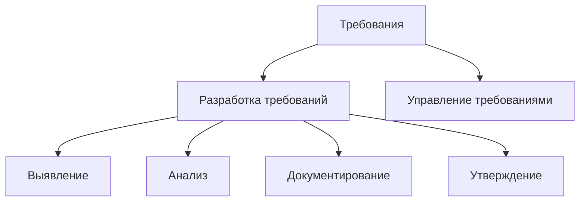

**Требования живут и развиваются** на протяжении всего жизненного цикла проекта. Независимо от [[Методологии разработки ПО|методологии проекта]] есть вещи, которые надо выполнить в отношении всех требований.

# 1 Выявление требований
---
**Выявление и сбор требований** охватывает все действия, связанные с выявлением требований, такие как интервью, совещания, анализ документов, создание прототипов и другие. Ключевые действия:
- Определение классов ожидаемых пользователей продукта и других заинтересованных лиц.
- Понимание задач и целей, а также бизнес-целей, которым соответствуют эти задачи.
- Изучение среды, в которой будет использоваться новый продукт.
- Работа с отдельными людьми, которые представляют каждый класс пользователей, чтобы понять их потребности и ожидания в отношении качества.
# 2 Анализ требований
---
**Анализ требований** подразумевает получение более обширного и точного понимания всех требований и представление наборов требований в различном виде. Ключевые действия:
- Анализ информации, полученной от пользователей, чтобы отделить их задачи от функциональных и нефункциональных требований, бизнес-правил, предполагаемых решений и другой информации. 
- Разложение высокоуровневых требований до нужного уровня детализации.
- Выведение функциональных требований из информации других требований.
- Понимание относительной важности атрибутов качества.
- Распределение требований по компонентам ПО, определенным в системной архитектуре.
- Согласование приоритетов реализации.
- Выявление пробелов в требованиях или излишних требований, не соответствующих заданным рамкам.
# 3 Документирование требований
---
**Документирование требований** предусматривает представление и хранение совокупного знания о требованиях постоянным и хорошо организованным способом. Ключевое действие – преобразование собранных потребностей пользователей в письменные требования и диаграммы, пригодные для понимания, анализа и использования целевой аудиторией.
# 4 Утверждение требований
---
**Утверждение требований** должно подтвердить правильность имеющегося набора требований, которые позволят разработчикам создать решение, удовлетворяющее бизнес-целям. Ключевые действия:
- Проверка задокументированных требований для устранения всех недостатков до принятия требований группой разработки.
- Разработка приемочных тестов и критериев, которые должны подтвердить, что созданный на основе требований продукт будет отвечать потребностям заказчика и удовлетворять поставленным бизнес-целям.
# 5 Управление требованиями
---
Основная задача **управления требованиями** заключается не в предотвращении изменений или усложнении их внесения – задача состоит в предугадывании и приспосабливании к ожидаемым реальным изменениям, чтобы снизить их разрушительное влияние на проект. Ключевые действия:
- Определение основной версии требований, моментальный снимок, который представляет согласованный, проверенный и одобренный набор функциональных и нефункциональных требований, обычно для конкретного выпуска продукта или итерации разработки.
- Оценка влияния предлагаемых требований и внедрение одобренных изменений в проект управляемым образом.
- Обновление планов проекта в соответствии с изменениями в требованиях.
- Обсуждение новых обязательств, основанных на оцененном влиянии изменения требований.
- Определение отношений и зависимостей, существующих между требованиями.
- Отслеживание отдельных требований до их проектирования, разработки и тестирования.
- Отслеживание состояния требований и действий по изменению на протяжении всего проекта.